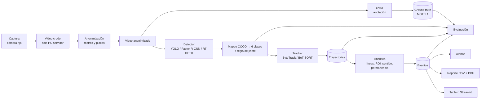
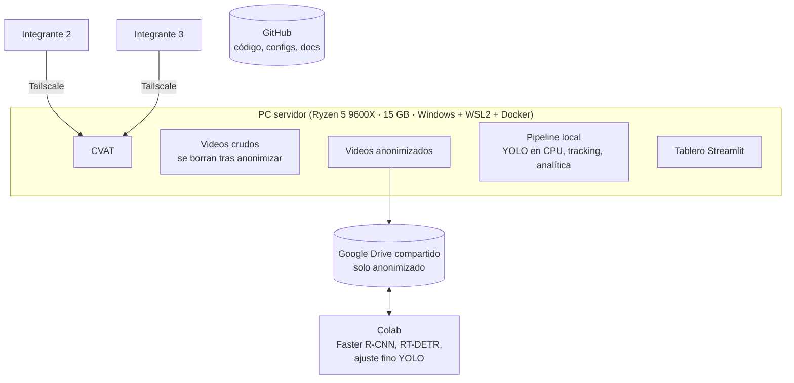
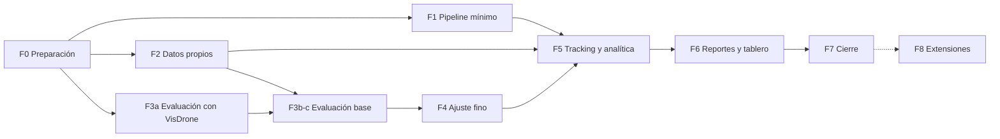

# Plan de acción — Video tracking e IA urbana

Versión 1 · 2026-10-07
Complementa la propuesta en borrador `Propuesta_Alcance_VideoTracking_IA_Urbana_limpio.docx.md`. Los cambios que este plan le hace a la propuesta están en el **Anexo A**.

---

## 0. Decisiones tomadas

| Tema | Decisión |
|---|---|
| Equipo | 3 integrantes, experiencia intermedia en Python/visión. Código en GitHub |
| Enfoque de modelado | Comparar **YOLO nano, Faster R-CNN y RT-DETR** preentrenados en COCO **sin entrenar**; luego **ajuste fino solo de YOLO nano** y medir cuánto mejora |
| Clases | Las 6 del borrador: peatón, bicicleta, motocicleta, automóvil, bus, camión |
| Cómputo | **Colab gratis** para los modelos pesados y el ajuste fino. **PC local** para CVAT, pipeline y tablero. Colab Pro solo si las sesiones gratis se vuelven cuello de botella |
| Anotación | **CVAT local** (Docker) en el PC servidor, acceso del equipo por **Tailscale** |
| Salida | **CSV + PDF + tablero Streamlit**; local primero, publicado después |
| Python | **3.12** (misma versión que Colab) |
| Arquitectura | **Limpia pragmática**: dominio, aplicación, adaptadores y entrada; interfaces solo donde hay más de una implementación. Nombres en inglés en el código |
| YOLO nano | **YOLO26n** (recomendado hoy por Ultralytics); se cambia con `--weights` |
| Plazo | Sin fecha fija: las fases están ordenadas para que cada una deje algo funcionando |
| Datos | Clips propios pendientes; mientras tanto se usan datasets públicos (Anexo B) |

---

## 1. Arquitectura

### 1.1 Flujo de datos



### 1.2 Principio central: un formato común entre etapas

Cada etapa escribe un archivo que la siguiente lee. Esto permite:
- correr los detectores pesados **una sola vez** en Colab y hacer todo lo demás localmente;
- cambiar de modelo sin tocar la analítica ni los reportes;
- que la evaluación lea exactamente los mismos archivos que usa el sistema.

| Artefacto | Contenido | Lo produce | Lo consume |
|---|---|---|---|
| Detecciones | Por cuadro: cuadro, clase, confianza, caja | Detector (local o Colab) | Tracker, evaluación |
| Trayectorias | Formato **MOT 1.1** + clase: cuadro, track_id, caja, confianza, clase | Tracker | Analítica, evaluación, tablero |
| Ground truth | MOT 1.1 exportado de CVAT | CVAT | Evaluación |
| Eventos | Un registro por cruce, entrada/salida de zona o alerta: track_id, clase, línea/zona, sentido, hora | Analítica | Reporte, tablero |
| Reporte | CSV (crudo + agregados) y PDF | Módulo de reporte | Personas |

Se usa MOT 1.1 porque CVAT lo exporta y TrackEval lo lee: la ground truth no necesita conversores.

### 1.3 Configuración por punto de cámara

Un archivo YAML por punto (`configs/puntos/P1.yaml`, …) con:
- **Líneas virtuales**: dos puntos + nombre de cada sentido (p. ej. norte→sur).
- **Zonas (ROI)**: polígonos (calzada, andén, zona de permanencia).
- **Reglas de alerta**: horario de restricción para camiones, umbral de aglomeración, tiempo máximo de permanencia.
- **Umbrales**: confianza del detector y solapamiento de la regla de jinete.

Se dibujan una vez por punto sobre un cuadro de referencia. Son perillas de calibración: se ajustan con los datos reales de cada cámara, no se fijan de antemano.

**Convención de nombres de video:** `P<punto>_<AAAAMMDD>_<HHMM>.mp4`. La franja horaria sale del nombre del archivo, no de los metadatos del celular (que pueden venir mal o vacíos).

### 1.4 Estructura del repositorio: arquitectura limpia pragmática

Decidida al iniciar la implementación (2026-10-07). Los nombres en el código van en inglés.

```
TrabajoDeCampo/
├── Docs/                    propuesta, plan, avance, guía de anotación, datasheet
├── configs/points/          un YAML por punto de cámara (lo único que se calibra)
├── vtia/
│   ├── domain/              reglas puras, sin librerías externas
│   │   ├── classes.py       6 clases + mapeo COCO
│   │   ├── models.py        Detection, Line, CrossingEvent
│   │   └── counting.py      cruce de línea, sentido, clase por mayoría
│   ├── application/         casos de uso + puertos (interfaces)
│   │   └── process_video.py
│   ├── adapters/            todo lo que toca librerías o archivos
│   │   ├── ultralytics_tracker.py
│   │   ├── yaml_config.py
│   │   └── csv_writer.py
│   └── cli.py               punto de entrada; conecta adaptadores y casos de uso
├── app/                     Streamlit (Fase 6): otro punto de entrada, misma aplicación
├── notebooks/               Colab: inferencia de modelos pesados y ajuste fino
├── tests/                   una prueba por cada lógica no trivial
└── data/                    NO va a git
```

- **Regla de dependencias:** `domain` no importa nada fuera de sí mismo; `application` solo importa `domain`; `adapters` y `cli` pueden importar todo.
- **Interfaces solo donde hay más de una implementación.** El puerto `Tracker` tendrá tres: YOLO, RT-DETR y Faster R-CNN.
- **El mapeo de clases va en el código**, no en un YAML (`domain/classes.py`), porque COCO → 6 clases es fijo.
- **Archivos que irán llegando:** `domain/` (regla de jinete, zonas, alertas), `adapters/` (Faster R-CNN, PDF, anonimización) y `application/` (evaluar, reportar). Cada archivo se divide solo cuando se vuelva difícil de manejar.

### 1.5 Infraestructura: dónde corre cada cosa



**Reglas de privacidad (Ley 1581 de 2012):**
1. El video crudo nunca sale del PC servidor.
2. Se borra después de anonimizar y verificar la anonimización por muestreo.
3. CVAT, Drive y Colab solo reciben video anonimizado.
4. GitHub nunca recibe videos.
5. El tablero solo se publica con datos anonimizados.

### 1.6 Librerías

| Necesidad | Librería | Motivo |
|---|---|---|
| YOLO, RT-DETR, ByteTrack, BoT-SORT | `ultralytics` | Los dos detectores y los dos trackers en una sola dependencia |
| Faster R-CNN | `torchvision` (ResNet-50 FPN v2, pesos COCO) | Implementación de referencia |
| Lectura de video | `opencv-python` | Estándar |
| Cruces de línea y zonas | `supervision` | Trae cruce de línea y zonas poligonales listos; evita geometría a mano |
| Métricas de tracking | `TrackEval` | HOTA, MOTA, MOTP, IDF1, ID switches. Verificar compatibilidad con numpy reciente en Fase 0 |
| mAP | `pycocotools` o `torchmetrics` | Métrica COCO estándar, incluye AP de objetos pequeños |
| Matriz de confusión y particiones | `scikit-learn` | Incluye `StratifiedGroupKFold` |
| Tablas y gráficas | `pandas`, `matplotlib` | Estándar |
| PDF | `ReportLab` | Python puro; WeasyPrint necesita GTK en Windows |
| Tablero | `streamlit` | Lo pide la propuesta |
| Anonimización | Se decide en Fase 2 | Depende de si las placas son legibles a la distancia de captura |

---

## 2. Diseño experimental

### 2.1 Experimentos

| ID | Qué se mide | Modelos | Entrenamiento | Dónde corre |
|---|---|---|---|---|
| E1 | Línea base sin entrenar | YOLO nano, Faster R-CNN, RT-DETR-L | Ninguno (pesos COCO) | Colab (pesados), local (YOLO) |
| E2 | E1 + regla de jinete | Los mismos | Ninguno | Igual |
| E3 | Ajuste fino | YOLO nano | k = 5 por grupos de clip | Colab |
| E4 | Comparación de trackers | Mejor detector + ByteTrack vs. BoT-SORT | Ninguno | Local |
| E5 | Error de conteo en videos largos | Mejor configuración | — | Local |

**Por qué E2:** en COCO el ciclista y el motociclista se anotan como `person` en una caja aparte del vehículo. Sin corrección, el conteo de peatones sale inflado. La regla es: si una persona se solapa con una bicicleta o moto por encima de un umbral, se elimina la persona y la caja del vehículo se extiende para cubrir a ambos. El umbral es calibrable. E1 contra E2 mide cuánto aporta esta regla sin entrenar nada.

### 2.2 Reglas para una comparación justa

- Mismo conjunto de prueba, misma resolución de entrada y mismo mapeo de clases para todos los modelos.
- El umbral de confianza se elige con datos de validación, **nunca** con los de prueba.
- Las clases COCO que no son ninguna de las 6 (perro, tren, etc.) se descartan.
- Los fps de todos los modelos se miden en el mismo hardware (Colab T4); YOLO se mide además en la CPU local.

### 2.3 Partición de datos

- **Prueba fija:** ~30 % de los clips, agrupada por clip y estratificada por punto y franja horaria. La usan E1 a E5. Nadie la mira para ajustar nada.
- **Resto (~70 %):** ajuste fino de YOLO con `StratifiedGroupKFold` k = 5 (grupo = clip). Se reporta media ± desviación estándar. El modelo final se entrena sobre todo el 70 %.
- **Limitación declarada:** con 2–3 puntos, la prueba comparte cámara con el entrenamiento, así que mide el desempeño en escenas conocidas. Experimento opcional: dejar un punto completo fuera del entrenamiento.

### 2.4 Métricas

Se mantienen las de la sección 9 de la propuesta, con estas correcciones:
- La matriz de confusión lleva una **fila "Fondo"** (detecciones que no corresponden a nada) además de la columna "No detectado". Sin esa fila, la precisión sale inflada.
- Las métricas de clasificación se calculan después de emparejar predicción y ground truth a IoU ≥ 0,5.
- Los ID switches se reportan también por cada 100 trayectorias, no solo por clip.
- El error de conteo se mide en los videos largos contra un conteo manual.

Los criterios de éxito de la sección 15 de la propuesta se aplican a la mejor configuración.

---

## 3. Fases

**Roles propuestos** (a confirmar por el equipo):
- **I1 — Datos e infraestructura.** Dueño del PC servidor: CVAT, Tailscale, captura, anonimización, gestión del dataset.
- **I2 — Modelos y evaluación.** Detectores, ajuste fino, métricas, análisis de errores.
- **I3 — Tracking, analítica y producto.** Tracking, conteo, alertas, reportes, tablero.
- **Anotación: los tres.** Es la carga de trabajo más grande del proyecto.

Cada fase cierra con un **hito verificable**.

### Fase 0 — Preparación

| Tarea | Responsable |
|---|---|
| Liberar 20–30 GB en C: (hoy está al 91 %; CVAT se reporta no saludable por encima del 90 %) | I1 |
| Instalar Python 3.12, recrear `.venv`, fijar dependencias en un `requirements.txt` que sirva igual en Colab | I2 |
| Crear repo en GitHub, `.gitignore` (data, videos, pesos), tablero de tareas por fase, regla: cada PR lo revisa otro integrante | I3 |
| Montar CVAT con Docker, `CVAT_HOST` = IP de Tailscale, cuentas para los 3, proyecto con las 6 clases | I1 |
| Instalar Tailscale en los 3 equipos y probar el acceso desde la casa de cada uno | Los 3 |
| Crear carpeta compartida en Drive (solo para material anonimizado) | I1 |
| Descargar los datasets públicos del Anexo B | I2 |
| Verificar la versión vigente de YOLO nano en Ultralytics y la compatibilidad de TrackEval | I2 |
| Actualizar la propuesta con los cambios del Anexo A | Los 3 |

**Hito:** los tres anotan una tarea de prueba en CVAT desde sus casas, y el entorno se instala en un PC limpio con un solo comando.

### Fase 1 — Pipeline mínimo de punta a punta

**Objetivo:** que entre un video y salga un CSV con conteos por clase y sentido. Feo pero completo; las fases siguientes lo mejoran.

- YOLO nano con pesos COCO + mapeo a las 6 clases → ByteTrack → una línea virtual → CSV de eventos y conteos.
- Implementado directamente con la arquitectura de la sección 1.4.
- Video de prueba: una secuencia de VisDrone o un clip grabado rápido con celular.
- Responsable: I3, con apoyo de I2.

**Hito:** un comando produce el CSV, y hay una prueba automática de la lógica de cruce de línea.

### Fase 2 — Datos propios

La fase más larga. Corre en paralelo con las Fases 1 y 3a.

**2a. Captura**
- Protocolo: 2–3 puntos, cámara fija a 3–6 m sin paneo, de día, franjas mañana/mediodía/tarde. Resolución y fps según los celulares (por confirmar).
- Dos tipos de captura:
  - **50–100 clips cortos** (10–20 s) para evaluación y ajuste fino.
  - **2–4 videos largos** (15–30 min) por punto, para los reportes: distribución por franja, permanencia y alertas. Corrige un vacío de la propuesta: los clips de 20 s no alcanzan para eso.
- Planilla por clip: punto, fecha, hora, clima, notas.
- Permisos y señalización del punto, según exija cada lugar.

**2b. Anonimización**
- Se hace antes de que cualquier video salga del PC servidor.
- El método se elige después de ver clips reales, según si rostros y placas son legibles a esa distancia.
- Se verifica por muestreo y se borra el crudo.

**2c. Guía de anotación** (`Docs/Guia_Anotacion.md`)
- Ciclista + bicicleta = una caja. Motociclista + parrillero + moto = una caja.
- Camioneta → automóvil. Buseta y microbús → bus. Volqueta y furgón → camión.
- Vehículos estacionados sí se anotan; la analítica solo cuenta los que cruzan la línea.
- Reglas de tamaño mínimo y oclusión.
- Casos no cubiertos (motocarro, chiva, carreta, patineta): decisión pendiente.

**2d. Anotación en CVAT**
- Modo **track** con ID e interpolación entre cuadros clave. Esto sirve a la vez para las métricas de tracking y, muestreando cuadros, para el ajuste fino.
- **Pre-anotación:** se corre un modelo grande que **no** esté en la comparación, se importa a CVAT y las personas corrigen. Se declara el riesgo de sesgo.
- Reparto: ~1/3 de los clips por persona. El 10 % lo anotan dos personas, para medir el acuerdo entre anotadores.
- Se mide el tiempo de los primeros 5 clips y se re-planifica con ese dato.
- Exportar las anotaciones a Drive periódicamente como respaldo.

**2e. Conteo manual de los videos largos.** Dos personas cuentan cada video por separado y luego reconcilian. Es la referencia del error de conteo.

**2f. Partición y datasheet.** Partición según la sección 2.3, dataset congelado con versión y fecha, y ficha de documentación.

Responsable: I1 lidera; los tres anotan.

**Hito:** dataset v1 congelado, con datasheet y partición fija.

### Fase 3 — Evaluación base sin entrenar (E1, E2)

- **3a. Validar el módulo de evaluación con VisDrone-MOT** (ground truth conocida). No espera los datos propios: confirma que las métricas se calculan bien antes de confiar en ellas.
- **3b.** Correr los tres detectores sobre la prueba (Colab) y guardar las detecciones en Drive.
- **3c.** Métricas, matrices de confusión, curvas precisión–recall y galería de los errores más confiados.
- Responsable: I2.

**Hito:** tabla comparativa E1/E2 con matrices y un primer análisis de errores.

### Fase 4 — Ajuste fino de YOLO (E3)

- Extraer 1 de cada N cuadros de los clips de entrenamiento (N calibrable; la propuesta dice 10) y exportar en formato YOLO.
- k = 5 por grupos de clip, con puntos de control en Drive en cada época (Colab corta sesiones).
- Aumento de datos según la sección 6.3 de la propuesta (sin volteo vertical).
- Comparar contra E1/E2 en la misma prueba.
- Opcional: probar en el dataset de Medellín (Anexo B) para ver el comportamiento en motos colombianas.
- Responsable: I2.

**Hito:** respuesta cuantitativa a "¿cuánto mejora ajustar?", con media ± desviación.

### Fase 5 — Tracking y analítica completa (E4, E5)

- ByteTrack vs. BoT-SORT con el mejor detector, medidos con TrackEval.
- Configuración por punto: líneas y zonas.
- Sentido de circulación, permanencia en zona y contraflujo.
- Alertas: contraflujo, camión en horario restringido, peatón en calzada, aglomeración.
- Error de conteo en los videos largos.
- Responsable: I3.

**Hito:** tabla de eventos y alertas por video, con el error de conteo medido.

### Fase 6 — Reportes y tablero

- **CSV:** crudo y agregados.
- **PDF:** conteo por clase, composición del tráfico, distribución por franja, sentido, permanencia, alertas y anexo de calidad (trayectorias seguidas, ID switches, confianza media).
- **Tablero Streamlit local:** elegir o subir un video, elegir punto y modelo, ver conteos, gráficas y alertas, descargar CSV/PDF. Reutiliza `vtia`, sin lógica propia.
- Responsable: I3, con apoyo de I1.

**Hito:** el criterio de éxito de la propuesta: un clip entra y el reporte completo sale sin intervención humana.

### Fase 7 — Cierre

Informe de evaluación, documento final, datasheet, repositorio limpio con README, video demostrativo de 3–5 minutos y sustentación. Responsables: los tres.

### Fase 8 — Extensiones (si hay tiempo, en orden de valor)

1. Publicar el tablero, solo con datos anonimizados y con autenticación.
2. Clasificador en cascada (MobileNetV3) para bici/moto y bus/camión.
3. Inferencia por mosaico (SAHI) para objetos pequeños.
4. Clases locales (motocarro, buseta) con el YOLO ajustado.
5. GPU AMD local (ROCm), para depender menos de Colab.
6. DeepSORT o BoT-SORT con reidentificación.

### 3.1 Dependencias entre fases



### 3.2 Trabajo en paralelo

| Bloque | I1 | I2 | I3 |
|---|---|---|---|
| Arranque | F0: CVAT, Tailscale, disco | F0: entorno, verificación de librerías | F0: repo y tablero de tareas |
| 1 | F2: captura y anonimización | F3a: evaluación con VisDrone | F1: pipeline mínimo |
| 2 | F2: anotación | F2: anotación + F3b | F2: anotación + configs de puntos |
| 3 | F2: conteos manuales | F4: ajuste fino | F5: analítica y alertas |
| 4 | F6: PDF | Análisis de errores | F6: tablero |
| Cierre | F7 | F7 | F7 |

---

## 4. Riesgos del plan

| Riesgo | Señal temprana | Respuesta |
|---|---|---|
| La anotación toma más de lo previsto | Tiempo medido en los primeros 5 clips | Pre-anotación; bajar a 50 clips; priorizar la prueba |
| PC servidor apagado, sin espacio o con falla | CVAT inaccesible | Horarios de anotación acordados; exportar anotaciones a Drive periódicamente |
| Colab corta las sesiones | Entrenamientos que no terminan | Puntos de control por época; pasar a Colab Pro |
| Pocas instancias de bus o camión | Menos de 15 en la prueba | Captura dirigida en corredores de carga; colapso a 4 clases (contingencia de la propuesta) |
| Anonimización incompleta | El muestreo encuentra rostros o placas legibles | No sale nada del PC servidor hasta corregirlo |
| Sesgo por pre-anotación | — | Pre-anotar con un modelo fuera de la comparación y revisar todo a mano |

---

## 5. Decisiones pendientes (se resuelven en su fase)

| Decisión | Fase |
|---|---|
| Ciudad, puntos de captura y permisos necesarios | F2 |
| Celulares o cámara, resolución y fps | F2 |
| Cómo anotar motocarros, chivas, carretas y patinetas | F2 |
| Método de anonimización | F2 |
| Umbral mínimo de F1 por clase: 0,60 o 0,65 (la propuesta dice ambos) | F0 |
| Quién asume I1, I2 e I3 | F0 |
| Dónde y cómo publicar el tablero | F8 |

---

## Anexo A — Cambios a la propuesta

1. **Objetivo de modelado:** pasar de "entrenar y comparar tres arquitecturas" a "comparar tres detectores preentrenados (YOLO nano, Faster R-CNN, RT-DETR) y ajustar YOLO nano". MobileNet pasa a extensión opcional.
2. **Anotación:** trayectorias con ID (modo track en CVAT), no solo cuadros clave con clase. Sin ellas no se pueden calcular MOTA, IDF1 ni HOTA.
3. **Captura:** agregar videos largos (15–30 min) para los reportes de franja, permanencia y alertas.
4. **Matriz de confusión:** agregar la fila "Fondo".
5. **Muestreo:** un clip de 10–20 s a 25–30 fps tiene 250–600 cuadros; 1 de cada 10 da 25–60 cuadros, no 15–25. Revisar también la estimación de 1.000–1.500 cajas.
6. **Umbral de F1 por clase:** unificar (§9.1 dice 0,65; §15 dice 0,60).
7. **Partición:** prueba fija + `StratifiedGroupKFold` k = 5 sobre el resto, en lugar de 70/15/15 y validación cruzada a la vez.
8. **§6.2:** YOLO clasifica con sigmoide y entropía cruzada binaria, no con softmax. La ponderación de clases no es un parámetro estándar de Ultralytics.
9. **Desajustes con COCO:** el jinete es una caja `person` aparte y las camionetas pickup salen como `truck`. Se resuelven con la regla de jinete (E2) y la guía de anotación.
10. **§7.1 y §7.3:** YOLO nano no llega a 30 fps en una CPU modesta, y EfficientNet-B0 tiene unos 5,3 M de parámetros, no menos de 3 M.
11. **§10.2:** "el resultado confirma…" se apoya en una matriz hipotética; cambiar a "se espera…".
12. **Cronograma:** reemplazar las semanas fijas por las fases de este plan.

## Anexo B — Datasets públicos para avanzar sin clips propios

| Dataset | Contenido | Uso en el proyecto | Tamaño | Limitación |
|---|---|---|---|---|
| [VisDrone2019-MOT](https://github.com/VisDrone/VisDrone-Dataset) (val) | Video con trayectorias anotadas; clases peatón, personas, bicicleta, carro, van, camión, triciclo, bus, moto | Desarrollar el pipeline (F1) y validar el módulo de evaluación (F3a) | 1,48 GB | Vista desde dron, no desde poste |
| [Motociclistas en zonas peatonales, Medellín](https://zenodo.org/record/7935299) (CC BY 4.0) | 6.324 imágenes 1280×720 de cámaras CCTV fijas de Medellín, formato YOLO; motos con y sin conductor, peatones en cruce | Prueba de contexto colombiano para motos y peatones (F4, opcional) | 644 MB | Solo imágenes; clases distintas, requiere mapeo |

UA-DETRAC queda descartado como dataset principal: solo trae vehículos y la descarga oficial tiene disponibilidad incierta.

## Fuentes

- Planes de CVAT en la nube: https://cvat.ai/pricing/cloud
- Instalación de CVAT: https://docs.cvat.ai/docs/administration/community/basics/installation/
- VisDrone: https://github.com/VisDrone/VisDrone-Dataset
- Dataset de Medellín: https://pmc.ncbi.nlm.nih.gov/articles/PMC10558723/
- Límites del plan gratis de Tailscale: https://costbench.com/software/business-vpn/tailscale/free-plan
